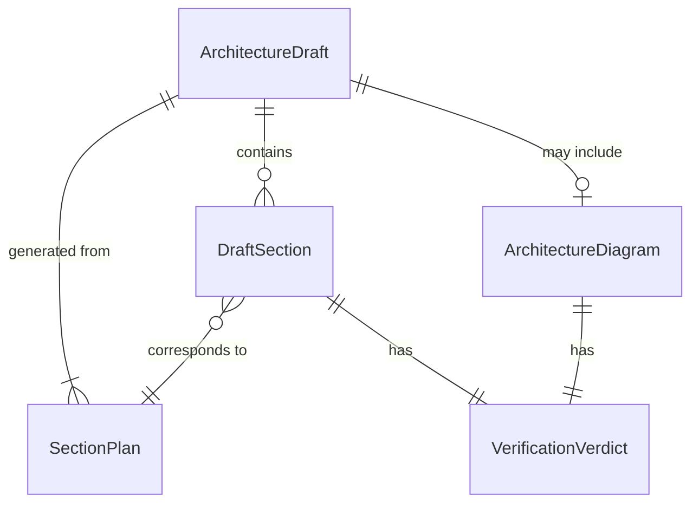
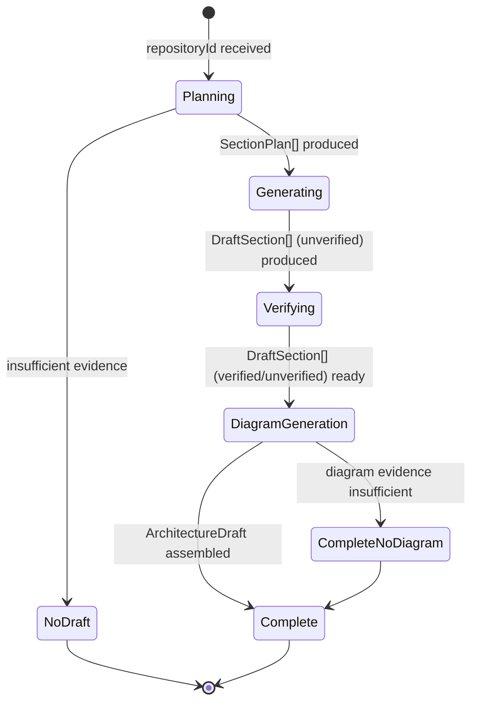

# Data Model: Grounded Architecture Drafting

**Feature**: `003-architecture-drafting` | **Date**: 2026-07-26

## Overview

Phase 2 produces in-memory data structures only — no new database tables, migrations, or schema changes are required. The existing `GeneratedDoc`, `DocSection`, and `DocStatus` models from Phase 1 are present in the Prisma schema but are not written to in this phase. Persistence is deferred to Phase 3.

The data model below defines the TypeScript interfaces used as the internal contract between the drafting pipeline services.

---

## Entities

### SectionPlan

A repository-specific proposed section derived from broad evidence analysis.

| Field | Type | Description | Constraints |
|---|---|---|---|
| `key` | `string` | Unique stable identifier for the section | Required, unique within a plan, kebab-case |
| `title` | `string` | Human-readable section title | Required, non-empty |
| `purpose` | `string` | One-line description of what this section covers | Required, non-empty |
| `retrievalTopic` | `string` | Focused topic for per-section retrieval | Required, non-empty |

**Validation rules**:
- Duplicate keys within a plan are discarded (keep first occurrence)
- Entries with empty/missing key, title, or retrievalTopic are discarded
- Keys must be non-empty strings; kebab-case is encouraged but not enforced

---

### VerificationVerdict

The outcome of independently verifying a section's claims against its evidence.

| Value | Meaning |
|---|---|
| `verified` | All material claims are supported by the provided evidence |
| `unverified` | One or more claims could not be grounded; section retained with notes |
| `removed` | Section could not be grounded at all and was removed from the draft |

---

### DraftSection

One generated and verified document section.

| Field | Type | Description | Constraints |
|---|---|---|---|
| `key` | `string` | Matches the `SectionPlan.key` this section was generated from | Required |
| `title` | `string` | Section title | Required |
| `contentMd` | `string` | Markdown body of the section | Required (may be empty if verdict is `removed`) |
| `sourceFiles` | `string[]` | Repository file paths cited in this section | Required (may be empty) |
| `verdict` | `VerificationVerdict` | Verification outcome | Required |
| `verificationNotes` | `string \| null` | Explanation when verdict is not `verified` | Null when verdict is `verified` |

**Validation rules**:
- Every `sourceFiles` entry must be a non-empty string
- `contentMd` must be empty when `verdict` is `removed`
- `verificationNotes` must be non-null when `verdict` is `unverified` or `removed`

---

### ArchitectureDiagram

A Mermaid representation of the repository's module architecture.

| Field | Type | Description | Constraints |
|---|---|---|---|
| `mermaidSource` | `string` | Valid Mermaid flowchart/graph source code | Required, non-empty |
| `modules` | `string[]` | Module names included in the diagram | Required |
| `verdict` | `VerificationVerdict` | Whether all modules are evidenced | Required |
| `verificationNotes` | `string \| null` | Explanation when diagram is unverified | Null when verified |

**Validation rules**:
- `mermaidSource` must start with `flowchart` or `graph`
- Every entry in `modules` must correspond to a module present in the retrieval evidence
- If validation fails, the diagram is omitted from the draft rather than returned with invalid syntax

---

### ArchitectureDraft

The top-level in-memory result for one repository drafting operation.

| Field | Type | Description | Constraints |
|---|---|---|---|
| `repositoryId` | `string` | The repository this draft was produced for | Required |
| `repositoryName` | `string` | Human-readable repository name | Required |
| `sections` | `DraftSection[]` | Ordered list of generated sections | Required (may be empty) |
| `diagram` | `ArchitectureDiagram \| null` | Architecture diagram, if producible | Null when no evidence available |
| `sectionPlan` | `SectionPlan[]` | The plan that was used to generate sections | Required |
| `sourceStatus` | `SourceStatus` | Retrieval availability diagnostics from Phase 1 | Required |
| `generatedAt` | `Date` | When the draft was produced | Required |

---

### DraftRequest

Input to the `DraftingOrchestratorService.draft()` method.

| Field | Type | Description | Constraints |
|---|---|---|---|
| `repositoryId` | `string` | The repository to draft for | Required, must exist and be indexed |

---

## Relationships

## State Transitions

The drafting pipeline is stateless from a persistence perspective. However, the pipeline's internal flow follows this sequence:

## Migration Requirements

**None.** Phase 1 already added the `GeneratedDoc`, `DocSection`, and `DocStatus` models to `prisma/schema.prisma`. This phase does not modify the database schema. Phase 3 will map the in-memory `ArchitectureDraft` to the existing Prisma models for persistence.
