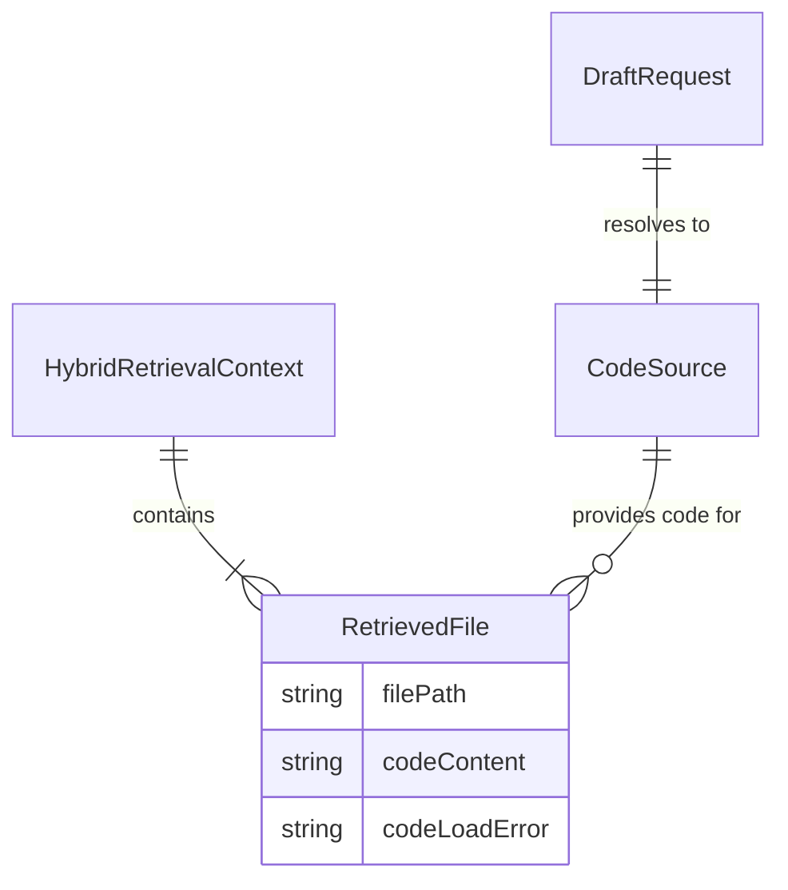
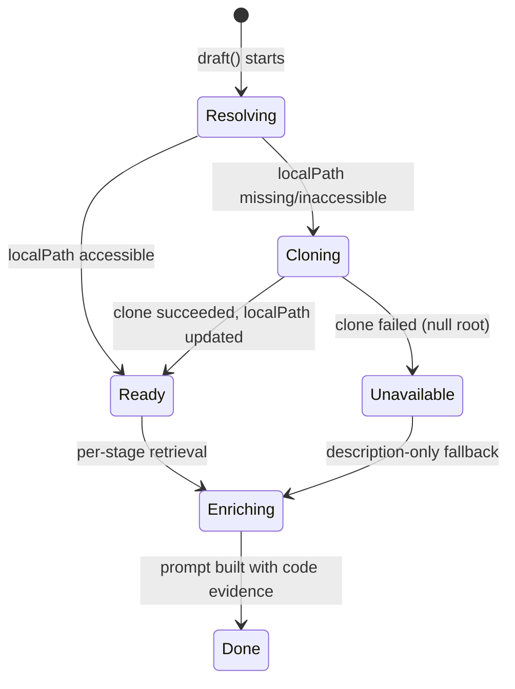

# Data Model: Code-Grounded Drafting

**Feature**: `006-code-grounded-drafting` | **Date**: 2026-08-03

## Overview

No database schema changes are required. This feature extends the in-memory drafting data model: `RetrievedFile` gains optional code evidence, `DraftRequest` gains the authorized `userId`, and a small `CodeSource` value is passed between drafting stages. The persisted models (`GeneratedDoc`, `DocSection`, `Repository`) are unchanged.

---

## Entities

### RetrievedFile (extended)

An in-memory evidence record for one repository file. Two optional fields are added.

| Field | Type | Description | Constraints |
|---|---|---|---|
| `filePath` | `string` | Canonical repository-relative path | Required, existing |
| `description` | `string \| undefined` | Stored AI description from the vector store | Existing |
| `semanticDistance` / `semanticRank` / `graphHop` | `number \| undefined` | Retrieval ranking signals | Existing |
| `evidenceSources` | `('semantic' \| 'graph')[]` | Which stores supplied this file | Existing |
| `combinedScore` | `number` | Ranking score used to decide which files get code | Existing |
| `codeContent` | `string \| undefined` | **NEW** Bounded snippet of the file's actual source code | Optional; set only when code was read successfully |
| `codeLoadError` | `string \| undefined` | **NEW** Inspectable reason the code could not be loaded | Optional; set when code was not read (missing path, binary, oversized, unreadable) |

**Validation rules**:
- `codeContent` and `codeLoadError` are mutually exclusive for a given file.
- If both are absent, the file contributes description-only evidence (fallback).
- `codeContent` length never exceeds `codeContextMaxCharsPerFile`.
- The sum of `codeContent` across one context never exceeds `codeContextMaxTotalChars`.
- At most `codeContextMaxFiles` files in one context have `codeContent`.

---

### DraftRequest (extended)

Input to `DraftingOrchestratorService.draft()`.

| Field | Type | Description | Constraints |
|---|---|---|---|
| `repositoryId` | `string` | Repository to draft for | Required, existing |
| `userId` | `string` | **NEW** Authorized user; used to re-clone when the local clone is missing | Required; already enforced for ownership before the job is enqueued |

---

### CodeSource (internal value)

Resolved, mutable clone root shared across the drafting stages of one job.

| Field | Type | Description | Constraints |
|---|---|---|---|
| `rootPath` | `string \| null` | Absolute path to the on-disk clone to read code from | `null` when no clone could be resolved |
| `repositoryId` | `string` | The repository the path belongs to | Required |
| `createdByDraft` | `boolean` | Whether this run re-cloned the repository | Used for logging and diagnostics |

The orchestrator resolves the `CodeSource` once per job and passes only `rootPath` into the stage services; stages do not re-resolve it.

---

## Relationships

## State Transitions

No new persisted state. The in-memory lifecycle of the code source is:

## Migration Requirements

**None.** No Prisma schema change, migration, or new table is introduced.
